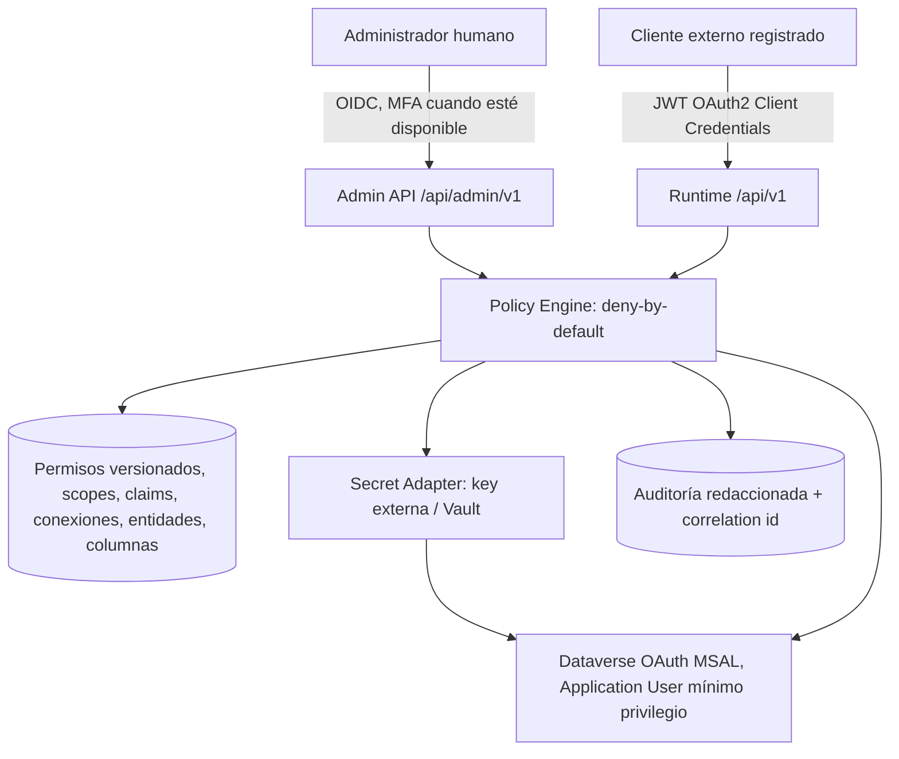

# Modelo de seguridad — Fase 00

- La identidad del cliente debe estar ligada a una **lista explícita de conexiones**, entidades, operaciones y columnas.
- Las credenciales de Entra para acceder a Dataverse **no** autentican automáticamente a consumidores externos.
- UI OIDC y API M2M se configuran por separado; issuer, audience y JWKS verificables, rotación segura.
- Los secretos cifrados AES-GCM con AAD por conexión, versión de clave y nonce único; clave fuera del DB y del repositorio.
- DNS, host, HTTPS, redirecciones y destinos de webhook restringidos, límites y tiempos de espera.
- Datos administrativos nunca en respuesta al cliente de solo lectura, ni selección de columnas libre.
- Endpoints admin exigen privilegios de usuario; operación destructiva requiere permiso y confirmación distinta.
- Controles de seguridad descritos **pendientes de implementación en fases siguientes**.
